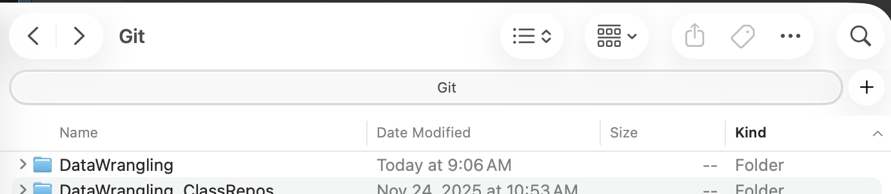
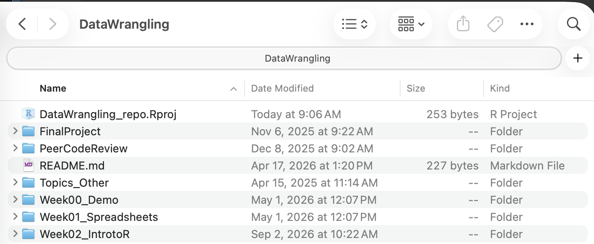
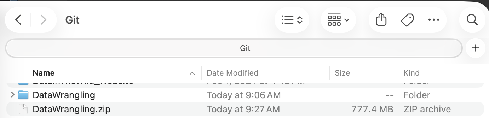

```{r setup, include=FALSE}
knitr::opts_chunk$set(echo = TRUE)
```

# Assignment Details

### Purpose

The goal of this assignment is to practice problem decomposition and some best practices in reproducibility .

### Task

Write R code to successfully answer each question below.

### Criteria for Success

- Code is within the provided code chunks or new code chunks are created where necessary
- Code chunks run without errors
- Code chunks have brief comments indicating which code is answering which part of the question
- Code will be assessed as follows:
  - Produces the correct answer using the requested approach: 100%
  - Generally uses the right approach, but a minor mistake results in an incorrect answer: 90%
  - Attempts to solve the problem and makes some progress using the core concept, but returns the wrong answer and does not demonstrate comfort with the core concept: 50%
  - Answer demonstrates a lack of understanding of the core concept: 0%
- Any questions requiring written answers are answered with sufficient detail

### Due Date

Oct 27 before class

# Assignment Exercises

For many of the exercises in this week's assignment, we will actually be using a lot of the code that you have already written for Assignment 7. This time, however, all of your file paths will be different...

### 1. Set-Up (20 pts)

Now that we are working outside of Posit Cloud, we will need to first *install* our packages onto your computer before we can load them with the `library()` function.

We use the `install.packages()` function to download the package from the internet and create a local copy. Unlike with the `library()` function, the package name needs to be inside quotation marks.

Insert a code chunk and (a) install and (b) load the `palmerpenguins` package. Since we already installed the `tidyverse` package during the lesson, you do not need to install it again. However, you do need to *load* it again.

Once you've installed `palmerpenguins`, comment out that line of code.

::: callout-note
## Important Note

If you haven't already, make sure you are working in your RStudio Project!

Your project should have sub-directories for raw data, clean data, figures, documents, and scripts. These are the folders (`data_raw`, `data_clean`, `figures`, `documents`, and `scripts`) that were in the folder you downloaded for the lesson.

Make sure that this Quarto file is in the appropriate sub-directory.
:::

### 2. Portal Data Paths Review (20 points)

For this question, we are going to be using some of the code you've already written for Assignment 8, Question 2.

Before you begin, ensure that this assignment file is in your `scripts` folder.

Now, let's code!

First, we need to download the Portal files that we know well. - [`surveys.csv`](https://ndownloader.figshare.com/files/2292172) - [`species.csv`](https://ndownloader.figshare.com/files/3299483) - [`plots.csv`](https://ndownloader.figshare.com/files/3299474)

a.  The code chunk below uses the `download.file()` function to go to a specific URL and then download the data at that URL. The location where the file is downloaded to is set by the `destfile` argument.

    Modify the path in the `destfile` argument for all three species datasets so that they are downloaded directly into your raw data folder (do not move them into the correct sub-directory after the fact).

```{r}
# surveys
download.file(url = "https://ndownloader.figshare.com/files/2292172",
              destfile = "surveys.csv")

# species
download.file(url = "https://ndownloader.figshare.com/files/3299483",
              destfile = "species.csv")

# plots
download.file(url = "https://ndownloader.figshare.com/files/3299474",
              destfile = "plots.csv")
```

b.  Load the 3 data frames (surveys, species, plots) from your raw data folder into R using `read_csv()`. Make sure your paths are *relative*, not absolute.
c.  Copy the answers from Week 8 Assignment, Questions 2d-f, into the code chunk below.
d.  Save the output of the code from `2d` as a new data frame. Then, save that resulting data frame as a CSV file *directly* into your clean data sub-directory using the `write_csv()` function.
e.  Save the plots from `2e` and `2f` *directly* into your `figures` folder using the `ggsave()` function.

### 3. Palmer Penguins and Path Files (20 points)

Like in Question 2 above, we will be recreating Question 4 from Week 8's assignment but within our own RStudio Project. As a reminder, this is the question that used the `palmerpenguins` data.

a.  First, use `read_csv` to bring in the data from the `adelie.csv`, `chinstrap.csv`, and `gentoo.csv`.
b.  Copy, modify, and then run the code from last week's assignment that you wrote to combine the three above datasets and have the output match the `penguins` data frame from the `palmerpenguins` data frame.
c.  Run the `setdiff()` function to make sure that your code worked (it shouldn't have any issues, but it is good to check!)
d.  Save your version of the cleaned penguins data directly into your clean data folder using relative file paths.

### 4. Using R Scripts (20 points)

Finally, we will be recreating Question 3 for Week 8's Assignment.

This time, however, you will NOT be doing so in this Quarto file. Instead, I want you to make and use an R script!

a.  Create a new R script or use the one we used in class--either is fine. Make sure it is in the correct sub-directory of your RStudio project. If you create a new script, I highly recommend saving it before you continue with this question (unsaved files can lead to wonky file path issues).
b.  Ensure that the `mammal-size-data-clean` text file is in the appropriate sub-directory in your RStudio Project.
c.  Now, using the code you wrote for the last assignment, modify the code so that it runs in your R script file.
d.  Again, use the `ggsave()` function to save the figures from `3b`, `3c`, and `3d` into your `figures` sub-directory.

### 5. Final Project Proposal (20 points)

In the `scripts` folder, you will find a file with a few questions about what dataset you are planning to use. If you don't have one in mind yet, don't worry! I'll provide a list with some options for you to explore.

Download the file from D2L, answer the questions, and place it in the `scripts` or `documents` folder of your RStudio Project.

## Turning in Your Assignment

To turn in your assignment, you will need to upload the entire folder that contains your `.Rproj` file and sub-directories.

For example, this `DataWrangling` folder is my folder with the RStudio Project that I use for all of the material for this class.

{width="75%" fig-align="center"}

Inside the `DataWrangling` folder, you can see the `DataWrangling.Rproj` file and various other files and folder.

{width="75%" fig-align="center"}

This `DataWrangling` folder (from the first image) is the folder you will be submitting in Brightspace. Yes, the whole folder!

Usually, the easiest way to do this is to go to your Files application, navigate to the folder, and right click on the folder you want to compress. You should see the option to "Compress", "Compress to ZIP file", or something along those lines.

{width="75%" fig-align="center"}

Upload the ZIP file to D2L.
