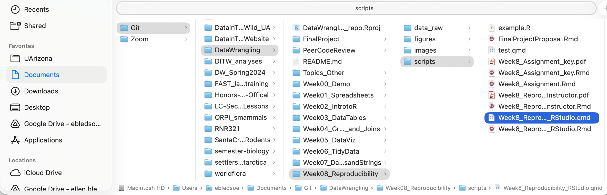

{width="75%"}

```{r eval = FALSE}
## Mac
"/Users/ebledsoe/Documents/Git/DataWrangling/Week08_Reproducibility/scripts/
Week8_Reproducibility.qmd"
## Windows
"C:/Users/ebledsoe/Documents/Git/DataWrangling/Week08_Reproducibility/scripts/
Week8_Reproducibility.qmd"
```

## Relative File Path

The working directory is the "DataWrangling" folder.


```{r eval=FALSE}
# File path from DataWrangling folder
"Week08_Reproducibility/scripts/Week8_Reproducibility.qmd"
```
